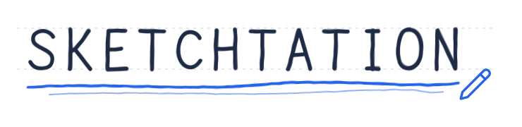

The live website is the canvas. A floating island toolbar sits at the bottom of the page. Sketch or select an element, write a note, and send the feedback to your coding agent. There is no API key or model call in Sketchtation.

## Use

1. Sign in to the local Codex CLI with `codex login` if it is not already signed in. No OpenAI API key is needed.
2. Run `npm start` in this folder, then open `http://127.0.0.1:4173`. This opens the website directly.
3. Draw over the website, or use **Note** to select a page element. A compact comment pill opens beside the selected element; submit a comment to leave a numbered marker. Add as many comments as you need. They stack on the page and are not sent until you press **Send**. Saving a comment does not copy file paths to your clipboard. Click a marker to view or remove that comment. The Draw button opens seven icon-based pen types with size and opacity controls; click it again to reopen the picker. Ctrl+Z undoes and Ctrl+Y redoes drawing changes when focus is outside text fields.
4. Press **Send to agent** when your comments, sketch, and design note are ready. A status bubble above Send shows progress. The local Codex CLI receives the instruction, current site code, stacked comments, and sketch image. It returns a proposed site; Sketchtation validates and writes the HTML and CSS. Literal text changes from comments are checked against the selected element. The original sketch is placed at its page coordinates. Only comments included in a successful run are removed; comments added while the agent works remain stacked. The browser refreshes as soon as the files are saved.
5. History stores a snapshot before each agent run.

The local server starts a new Codex CLI run for each Send. It does not post into an existing Codex chat. The CLI uses its own sign-in state.

## Structure

- `site/index.html` and `site/styles.css` — editable website
- `site/editor/` — floating toolbar, drawing module, and tool icons
- `site/logo.svg` — Sketchtation wordmark
- `site/sketches/` — sketches applied to the website
- `.feedback/` — saved comments in `annotations.json`, latest handoff in `pending.json`, and sketch PNGs
- `.history/` — backups from the local apply endpoint
- `server.mjs` — local web server and feedback storage

The pen types and drawing behavior were inspired by [Drawesome](https://github.com/benjitaylor/drawesome) by Benji Taylor (MIT). Sketchtation uses its own plain JavaScript drawing module so the toolbar can overlay a live website without React.
